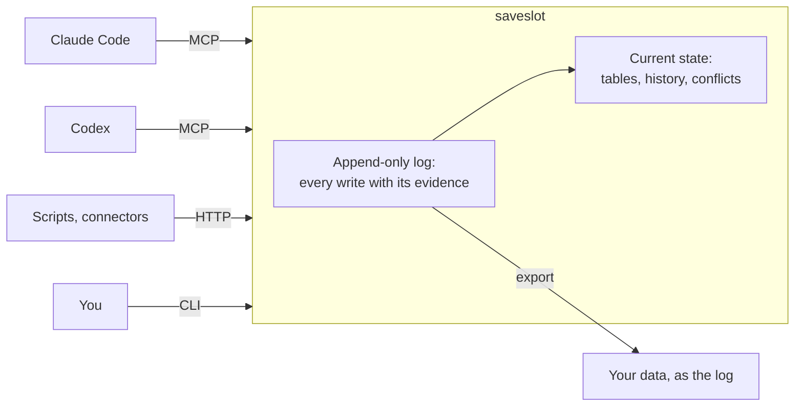

#  saveslot

English · [简体中文](README.zh-CN.md)

[](https://github.com/fluxvita/saveslot/actions/workflows/ci.yml)
[](https://www.npmjs.com/package/@fluxvita/saveslot)
[](LICENSE)
[](https://www.npmjs.com/package/@fluxvita/saveslot)

**saveslot is the database all your AI agents share.** Tell one agent you ran 5 km; ask another how far you ran this week. Every value keeps its sources and its history, and the data stays yours.

## See it

A short recording will go here: you tell one agent about a run, ask a second agent how far you ran this week, then ask how it knows, and it shows the sentence the number came from.

## Get started

You need Node 24.22.1 or later on the 24 line, or 26.12.1 or later.

```sh
npm install -g @fluxvita/saveslot
saveslot setup      # pick the running template; it adds saveslot to Claude Code and Codex
```

Then tell your agent:

> I ran 5 km this morning in 28 minutes, felt easy.

The first time, Claude Code asks whether the agent may use saveslot's tools; allow it. The run is now on record, with your words as its evidence: ask any connected agent about it, or run `saveslot query health.runs`.

Server mode, other hosts, scripts without a terminal and installing from source: [`docs/guide/11-deployment.md`](docs/guide/11-deployment.md) and [`docs/spec/06-cli.md`](docs/spec/06-cli.md) §3 (which also covers `EACCES` from `npm install -g` on Linux).

## What it is

- **Time is first-class.** saveslot stores the timeline of a thing: what it is now, how it got there, and the evidence behind every step.
- **Agents interpret, saveslot enforces.** The agent turns what you say into structured writes; saveslot only checks, records and executes, deterministically, and calls no model on its core path.
- **All state comes from one append-only log.** Everything else is derived from it, so an export is the log, and replaying it on any backend yields the same state.



## How it differs

| | What it keeps | Who reads and writes it | Why a value changed |
|---|---|---|---|
| A database | The current values | The programs you write | Not recorded |
| An agent's built-in memory | Things that were said | That one agent | Not recorded |
| saveslot | The timeline of each thing | All of your agents | Every value carries its sources and its history |

## What it connects to

| Host | How it is added |
|---|---|
| Claude Code | `saveslot setup` adds it |
| Codex | `saveslot setup` adds it |
| Cursor | `saveslot connect cursor` prints the configuration to paste |
| Claude Desktop | `saveslot connect claude-desktop` prints the configuration to paste |

Agents reach saveslot over MCP: locally through `saveslot mcp`, and in server mode over remote MCP, signing in with OAuth. Scripts and connectors use HTTP; people use the `saveslot` command.

## Status

**0.1** is the first release, with a local mode and a server mode (hosted or self-hosted). saveslot is before 1.0: interfaces may change between minor versions. Some parts of the design are not in 0.1 yet; [what 0.1 includes](docs/spec/07-scope-v1.md) is in section 7 of the scope.

## Documentation

The guide and the specification are kept in two editions, English under [`docs/`](docs/README.md) and Chinese under [`docs/zh-CN/`](docs/zh-CN/), aligned in meaning: a change to one changes the other in the same pull request, and a difference between them is a defect, to be reported as an issue. The decision records, walkthroughs and research notes are in Chinese only for now; the index lists them.

| Where | What |
|---|---|
| [`docs/guide/`](docs/guide/README.md) | Guide: a narrative introduction, read in order |
| [`docs/spec/`](docs/spec/README.md) | Specification: the authoritative definition of behavior |
| [`docs/`](docs/README.md) | Index of every document in both editions |

## Getting help and contributing

- Questions: [Discussions](https://github.com/fluxvita/saveslot/discussions); bugs and tasks: [Issues](https://github.com/fluxvita/saveslot/issues). See [`SUPPORT.md`](SUPPORT.md).
- Security issues: privately, as [`SECURITY.md`](SECURITY.md) says.
- Contributing: [`CONTRIBUTING.md`](CONTRIBUTING.md), with how to run the tests; how the code is laid out and the toolchain: [`docs/guide/12-contributing.md`](docs/guide/12-contributing.md). Who decides what: [`GOVERNANCE.md`](GOVERNANCE.md). Everyone follows the [Code of Conduct](CODE_OF_CONDUCT.md).

## Development

Read the [development guide](docs/development.md) first: set up, run the checks, run one test, find where a change belongs, and rehearse a small fix. How the code is organized and why is in [guide chapter 12](docs/guide/12-contributing.md) and [spec `02-architecture.md`](docs/spec/02-architecture.md).

For agents: follow [`AGENTS.md`](AGENTS.md).

## License

[Apache-2.0](LICENSE), for the code and the documents alike. The name and logo are covered by the [trademark policy](TRADEMARKS.md).
