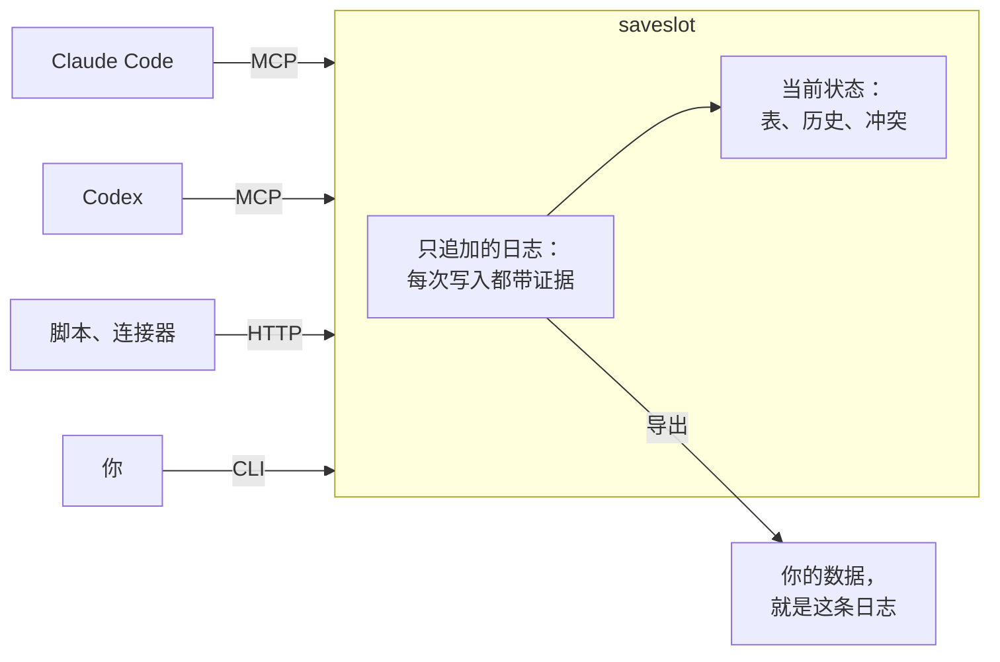

<picture>
  <source media="(prefers-color-scheme: dark)" srcset="docs/assets/readme-banner-dark.png">
  <source media="(prefers-color-scheme: light)" srcset="docs/assets/readme-banner-light.png">
  
</picture>

# saveslot

[English](README.md) · 简体中文

[](https://github.com/fluxvita/saveslot/actions/workflows/ci.yml)
[](https://www.npmjs.com/package/@fluxvita/saveslot)
[](LICENSE)
[](https://www.npmjs.com/package/@fluxvita/saveslot)

**saveslot 是所有 AI 共用的开源数据库。** 跟一个 Agent 说你跑了 5 公里，再问另一个这周跑了多少。每个值都带着出处和历史，数据归你。

## 上手

需要 Node 24 系列的 24.22.1 及以上，或 26.12.1 及以上。

```sh
npm install -g @fluxvita/saveslot
saveslot setup      # 模板选 running；它会把 saveslot 加进本机找到的 Agent，如 Claude Code 与 Codex
```

然后对 Agent 说：

> 今天早上跑了 5 公里，28 分钟，挺轻松。

第一次用时 Claude Code 会问是否允许 Agent 使用 saveslot 的工具，选允许。这次跑步就记下了，证据是你的原话：问任何一个接上的 Agent 都能答，或者执行 `saveslot query health.runs`。

服务器模式、别的宿主、没有终端的脚本、从源码安装，见 [`docs/zh-CN/guide/11-deployment.md`](docs/zh-CN/guide/11-deployment.md) 与 [`docs/zh-CN/spec/06-cli.md`](docs/zh-CN/spec/06-cli.md) 第 3 节（Linux 上 `npm install -g` 报 `EACCES` 也在那里）。

## 它是什么

- **时间是一等公民。** saveslot 存一样东西的时间线：现在是什么、怎么变成这样、每一步凭什么。
- **Agent 理解，saveslot 把关。** Agent 把你说的话变成结构化写入；saveslot 只做确定性的检查、记录与执行，核心路径不调用模型。
- **所有状态出自一条只追加的日志。** 其余一切都由它算出，所以导出就是这条日志，在任何后端上重放都得到同样的状态。



## 和别的东西有什么不同

| | 存什么 | 谁来读写 | 值为什么变了 |
|---|---|---|---|
| 一般的数据库 | 当前的值 | 你写的程序 | 不记 |
| Agent 自带的记忆 | 说过的话 | 那一个 Agent | 不记 |
| saveslot | 每样东西的时间线 | 你所有的 Agent | 每个值都带着出处和历史 |

## 能接什么

| 宿主 | 怎么接上 |
|---|---|
| Claude Code | `saveslot setup` 自动接上 |
| Codex | `saveslot setup` 自动接上 |
| Cursor | `saveslot connect cursor` 打印要粘贴的配置 |
| Claude 桌面端 | `saveslot connect claude-desktop` 打印要粘贴的配置 |

Agent 经 MCP 连 saveslot：本机经 `saveslot mcp`，服务器模式走远程 MCP，多数宿主用 OAuth 登录授权，Cursor 用 `saveslot connect http` 签发的令牌（[`06-cli.md`](docs/zh-CN/spec/06-cli.md) 第 3.2 节）。脚本与连接器用 HTTP；人用 `saveslot` 命令。

## 状态

**0.1** 是第一个发布版本，有本机模式和服务器模式（云托管或自部署）。saveslot 还在 1.0 之前：小版本之间接口可能变化。设计里有些部分 0.1 还没有提供，见 [0.1.0 提供哪些](docs/zh-CN/spec/07-scope-v1.md#7-010-提供哪些)。

## 文档

文档都在 `docs/` 下，两个目录各管一件事。规格与讲解有中文与英文两个版本：中文版在 `docs/zh-CN/`，英文版在 `docs/` 下去掉 `zh-CN/` 的同名路径，清单见 [`docs/README.md`](docs/README.md)。两个版本语义对齐：改一个就在同一个拉取请求里改另一个，两者不一致算缺陷，请提 Issue。

| 目录 | 读什么 |
|---|---|
| [`docs/zh-CN/guide/`](docs/zh-CN/guide/README.md) | **讲解**：给第一次接触的人，顺着读。解决什么问题、一个例子走到底、核心概念、架构、各机制为什么这样设计 |
| [`docs/zh-CN/spec/`](docs/zh-CN/spec/README.md) | **规格**：每条规则的完整定义，给实现与审查用，按需查。目录与阅读顺序见 [`docs/zh-CN/spec/README.md`](docs/zh-CN/spec/README.md) |

讲解与规格不一致时以规格为准。

## 求助与参与

- 提问去 [Discussions](https://github.com/fluxvita/saveslot/discussions)，缺陷与任务提 [Issues](https://github.com/fluxvita/saveslot/issues)，见 [`SUPPORT.md`](SUPPORT.md)。
- 安全问题按 [`SECURITY.zh-CN.md`](SECURITY.zh-CN.md) 私下报告。
- 参与贡献：[`CONTRIBUTING.zh-CN.md`](CONTRIBUTING.zh-CN.md)。谁决定什么见 [`GOVERNANCE.md`](GOVERNANCE.md)，参与者遵守[行为准则](CODE_OF_CONDUCT.md)。

## 开发

先读[开发上手](docs/zh-CN/development.md)：搭环境、跑检查、只跑一个测试、找到改动该落在哪、演练一次小修复。代码怎么组织、为什么这样组织，见[讲解第 12 章](docs/zh-CN/guide/12-contributing.md)与[规格 `02-architecture.md`](docs/zh-CN/spec/02-architecture.md)。

给 Agent：遵循 [`AGENTS.md`](AGENTS.md)。

## 许可证

[Apache-2.0](LICENSE)，代码与文档相同。名字与标识的使用见[商标政策](TRADEMARKS.zh-CN.md)。
